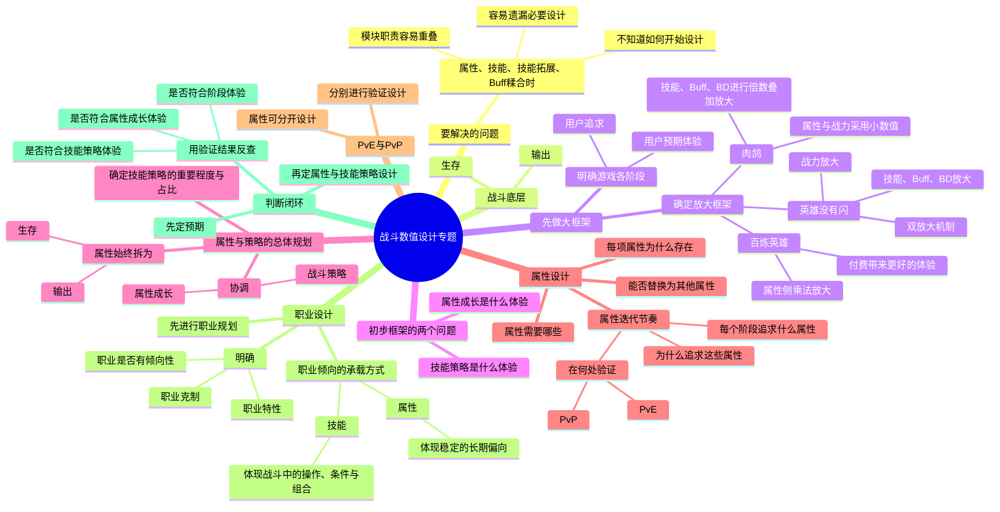
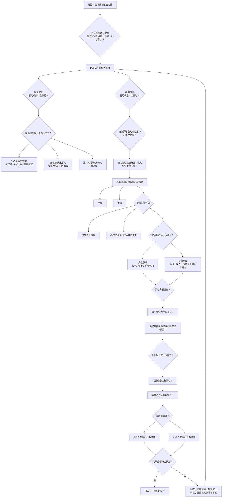

# 战斗数值设计专题：会话记录

> 导出时间：2026-08-25
>
> 范围：本任务中用户与助手的可见对话内容；不含系统消息、内部推理、工具调用和子任务内部记录。

---

## 1. 初始请求

**用户**

基于这个文档做一个战斗数值设计的专题

**助手**

我会先定位并读取当前工作区指定的文档入口与可用资料，再将内容整理成一份可落地的“战斗数值设计”专题。

**用户**

基于这个文档做一个战斗数值设计的专题，先给我设计框架：https://forever9.feishu.cn/docx/Kf8ldtJwOof4cPxGBIMcfBu0nqb

**助手**

我会按工作区的 GDD 写作流程处理：先由独立分析阶段读取你提供的飞书文档，再把“战斗数值设计专题”的框架作为方向稿提出，供你确认后再进入正文。现在先读取飞书文档与该流程规范。

已进入 G1「设计目的还原」：这一步只还原原文中的上级框架、战斗循环与问题缺口，不会先把具体数值机制或目录当成既定方向。随后会做目的质询，并把“专题框架”的候选整理给你确认。

文档内容正在按引用证据拆解；我会把原文明确支持的事实与推断分开，避免把经验性数值结论混进框架。

---

## 2. 改为先问答与功能逻辑拆解

**用户**

不要直接写了，调用问答 skill 先进行功能逻辑拆解

**助手**

明白，切换为“先问答、再功能逻辑拆解”，不再推进专题正文或框架定稿。我先定位工作区中的问答 Skill；若它存在，会按其流程从文档中提问和澄清，再输出功能逻辑拆解。

当前工作区没有名为“问答”的 Skill；我将改用“游戏机制拆解”流程，先通过问答确定功能逻辑，不直接写专题正文。

第一问：这份专题要拆解的是文档里的“通用战斗数值设计方法”，还是要落到某个具体项目/玩法（请说明 PvE、PvP 或具体战斗模式）？

**用户**

看看工程下有什么问答 skill

**助手**

我会扫描工程内所有 `SKILL.md` 与名称含“问答/访谈/澄清”的目录和说明，确认是否有可用入口。

工程下没有名为“问答”或“Q&A”的 Skill。

可用于你这项工作的最接近入口是：

- [游戏机制拆解](/Users/mt/Documents/Codex-codex-work/archive/skills/skills/游戏机制拆解/SKILL.md)：可先做功能逻辑、循环、接口、边界与失效条件拆解。
- [GDD 写作](/Users/mt/Documents/Codex-codex-work/archive/skills/skills/gdd-write/SKILL.md)：用于确认逻辑后形成专题正文。

我会先按“游戏机制拆解”进行问答式功能逻辑拆解。

**用户**

有个 git 的

**助手**

我再从 Git 已跟踪文件、分支和子模块里查一次；刚才只扫了当前工作树可见的文件，可能漏掉未检出的 Skill。

当前 Git 记录里确实有一个 QA 检查 Hook（`.agents/hooks/checkpoint-qa.sh`），但它不是问答 Skill。我继续核对 `archive/skills` 是否是独立 Git 仓库，以及 Skill 目录的目录清单。

我查了当前工程的 Git 跟踪文件、历史与 Skill 清单：没有“问答 / Q&A”Skill。

唯一相关的是 [checkpoint-qa.sh](/Users/mt/Documents/Codex-codex-work/.agents/hooks/checkpoint-qa.sh)，它只是任务完成后的 QA 检查点，不是问答流程。

工程的 Skill 源仓库被配置在外部路径，但你还没给出具体仓库或链接。你说的“Git 的”是哪个 GitHub/Git 仓库？发我链接或名称，我就去定位并使用它。

**用户**

有个从 git 上下载的

**助手**

理解了：你指的是已从 Git 拉取并安装到本机运行时目录的 Skill。我会检查本机的已安装 Skill 目录与目录名，再定位“问答”相关入口。

找到了：从 Git 安装的 [grilling](/Users/mt/.codex/skills/grilling/SKILL.md) 正是逐题问答、逐步澄清依赖的流程。我将按它先进行功能逻辑拆解，每次只问一个关键问题。

已启用 Git 安装的 `grilling` 问答流程。

第一个问题：这次专题是否先锁定为“通用战斗数值设计方法论”，不处理某个具体项目的数值方案？

我建议先这样定，因为参考文档只提供通用设计与验证逻辑，没有某项目的职业、敌人、成长投放或 PvE/PvP 数据。

---

## 3. 明确专题要解决的问题

**用户**

方向错误，战斗数值设计专题，解决什么问题

**助手**

对，第一问应先锁定它解决的设计问题。

这份专题是否要解决：**如何把预期的战斗体验，转成属性、技能、敌人强度、公式与成长投放，并验证最终战斗仍按预期让玩家感到操作、策略与养成有价值？**

我建议以此为核心问题，而不是从“做通用还是项目方案”切入。

**用户**

不对，核心问题是，在进行战斗数值设计时，属性、技能、技能拓展、buff 这些东西糅合在一起时不知道如何进行设计或者会有设计的遗漏

**助手**

明白。核心问题是：**战斗能力由属性、技能、技能拓展与 Buff 共同构成时，缺少一套关系与覆盖检查方法，导致设计时不知道从哪里开始、各模块职责重叠，或遗漏必要环节。**

下一问：专题是否以“玩家侧能力系统”为主体，同时明确它与敌人、战斗规则之间的输入输出关系？

我建议这样定：主体聚焦玩家侧，接口必须纳入敌人与规则；否则无法判断一项属性或 Buff 最终在战斗中验证了什么。

**用户**

首先你的逻辑错误，战斗底层由 2 个东西决定，生存和输出

**助手**

对，底层不应先按“属性、技能、Buff”分模块，而应先按战斗结果拆成两件事：**生存**与**输出**。属性、技能、技能拓展和 Buff 都只是改变这两项结果的手段。

下一问：是否将所有战斗内容都先归入“提升/削弱生存”或“提升/削弱输出”，而控制、位移、资源、时序等只作为影响这两者的条件？

我建议这样定义，避免把表现形式当成独立底层。

**用户**

你不要发散，跟着我的思路走，你太傻了

**助手**

收到。我不再自行扩展。

当前只记录你的前提：**战斗底层由生存和输出决定。**

你继续讲下一步，我按你的顺序整理。

---

## 4. 大框架、属性与策略体验

**用户**

在进行战斗数值设计时，先要进行大框架的设计，这个大框架指的是在当前游戏中，我预期每个阶段的用户体验和追求是什么以及是什么样的

**助手**

记录：战斗数值设计先做大框架。

大框架要先明确：在当前游戏的每个阶段，玩家预期获得什么体验、追求什么，以及这些追求具体呈现为什么样。

**用户**

例如：肉鸽游戏，我需要做属性/战力上的小数值，通过技能、buff，BD 来进行倍数叠加的放大。

再例如：英雄没有闪，做的是战力 + 技能/Buff/BD 的双放大机制。

**助手**

记录两个大框架示例：

- 肉鸽：属性与战力采用小数值；通过技能、Buff、BD 的叠加形成倍数放大。
- 《英雄没有闪》：战力与技能 / Buff / BD 分别提供放大，构成双放大机制。

**用户**

百练英雄则是另外一个思路，在属性上做乘法，以达到付费带来更好体验的目的

**助手**

记录第三种大框架：

- 《百练英雄》：在属性侧做乘法放大，让付费直接带来更明显、更好的战斗体验。

**用户**

从这里能够看出来，在初步制定战斗数值框架时，需要思考两个问题，属性成长是什么体验？技能策略是什么体验？

**助手**

因此，初步制定战斗数值框架时，先回答两个问题：

1. 属性成长要给玩家什么体验？
2. 技能与策略要给玩家什么体验？

**用户**

在确定好这两者之后我们可以继续往下推进更细节的数值设计，属性成长体验定下来，我们则要思考需要哪些属性，为什么要这些属性，换成其他行不行

**助手**

下一层是属性设计：属性成长体验确定后，再逐项判断：

- 需要哪些属性；
- 每个属性为什么必须存在；
- 换成其他属性，是否仍能支撑已确定的成长体验。

**用户**

同时思考一个问题，属性迭代的节奏是怎么样的？在用户的每个阶段追求什么属性，为什么是这些属性，验证点在哪里，是 pvp 还是 pve 等等

**助手**

并行确定属性迭代节奏：

- 每个阶段让玩家追求什么属性；
- 为什么该阶段追求这些属性；
- 属性在何处被验证，以及验证场景是 PvE、PvP，还是两者都有。

**用户**

当然属性可以拆解成生存和输出来看，这个核心保持不变；在进行规划的时候同时考虑一个问题，技能策略在整个游戏中的重要程度以及占比，属性和战斗策略需要考虑到

**助手**

属性仍始终按两类结果审视：生存与输出。

规划时还要同时确定：技能与战斗策略在整个游戏中的重要程度和占比，并据此协调属性成长与战斗策略各自承担的部分。

**用户**

在属性设计同时可以将 pve 和 pvp 分开设计，分别进行不同的验证设计

**助手**

属性设计时，可将 PvE 与 PvP 分开规划，并分别设置各自的验证设计。

**用户**

基于这些我们来判断属性和技能策略的设计是否符合我们的预期？先定预期，再定设计

**助手**

判断顺序明确为：

**先定预期体验，再定属性与技能策略设计，最后用 PvE、PvP 的验证结果判断是否符合预期。**

---

## 5. 对《战斗数值框架搭建》的思路审核

**用户**

基于这个来看 [https://forever9.feishu.cn/docx/VwkNdFHeXonzzWxQRWfc0XFantf](https://forever9.feishu.cn/docx/VwkNdFHeXonzzWxQRWfc0XFantf) 这个文档从思路上有什么可以优化的地方

**助手**

我会按 GDD 审核流程，只评这份文档的设计思路是否与您刚确定的判断顺序一致：先定阶段体验预期，再设计属性与技能策略，并分 PvE/PvP 验证；不会直接改写文档。

我正在以你刚给出的判断链逐项对照文档：先看它是否先定义阶段体验与两类结果，再看属性、技能、Buff、BD 是否有各自的设计位置与 PvE/PvP 验证闭环。

已读到主文及其引用的属性、公式细化文档。初步看，它认可“体验优先”和 PvE/PvP 分开，但还没有把你刚定的判断链作为明确的先后关系。正在收敛为带文档位置的具体问题。

相对你刚确定的判断链，这份 [《战斗数值框架搭建》](https://forever9.feishu.cn/docx/VwkNdFHeXonzzWxQRWfc0XFantf) 最大的问题是：**已有内容很多，但判断顺序仍从 TTK、属性体系、公式与平衡切入，没有先把“玩家为何追求、属性和策略各承担什么”定下来。**

建议优化为以下七点：

1. 在“战斗数值的 3 个核心问题”之前，先定义战斗底层结果：**生存与输出**。  
   这样属性、技能、Buff、BD 都能判断自己是在改变生存、输出，还是两者，而不是并列罗列。

2. 在“体验驱动步骤 1–2”中，先写**每个阶段的用户体验与追求**，再写该阶段打不同怪的 TTK。  
   现文档把阶段主要处理为时长差异，尚未回答“这一阶段玩家为什么要追求某个属性或 BD”。

3. 在“框架驱动步骤 2–5”之间补一层：  
   **属性成长体验是什么；技能策略体验是什么；两者各自占战斗结果的多大比重。**  
   否则属性、技能、技能拓展、Buff 仍是并列模块，无法控制最终由属性还是策略主导胜负。

4. 强化“体验驱动步骤 3：推导属性”。  
   现在有穷举、分类、依赖关系，但还应逐项回答：  
   **为什么必须有这个属性；删除它会失去什么；换成其他属性能否仍实现预期体验。**  
   这才是防止属性职责重叠与设计遗漏的检查点。

5. 将“成长曲线”和 PvE/PvP 章节连成一个判断链：  
   **每阶段追求什么属性 → 为什么追求 → 在 PvE/PvP 的哪类场景验证。**  
   现文档分别讨论曲线与 PvE/PvP，但尚未把属性阶段目标与验证场景一一绑定。

6. 将“PvE/PvP 必须解耦”从绝对结论改为条件判断。  
   是否解耦、解耦到属性、技能、伤害乘区还是其他层，应由两类场景的体验目标和验证差异决定，而不是先固定“两套独立增减伤乘区”。

7. 扩展“交叉验证／验证与调优”。  
   除碾压、势均力敌、极端值、属性价值外，还要反查：  
   **阶段体验是否达成、属性成长体验是否达成、技能策略占比是否符合预期。**  
   否则只能发现数值越界，难发现“数值没错，但玩家追求或策略价值错了”。

我建议把文档的总顺序重排为：

`生存/输出 → 阶段体验与追求 → 属性成长体验与技能策略体验及占比 → 属性/技能/Buff/BD 细化 → 属性迭代与投放 → PvE/PvP 分别验证 → 验证结果反查预期`

**用户**

方向上是没太大问题的，但是仍然不能指导具体设计；尤其是技能、职业、流派、策略这部分

**助手**

对。它的大方向没问题，缺的是把“大框架”翻译成**技能、职业、流派、策略的具体设计规则**这一层。

目前文档从体验直接进入属性、公式、TTK，导致这几个内容只能被当作要填的模块，无法指导设计者回答：

- 职业之间究竟靠什么方式分别解决生存和输出；
- 技能应提供基础能力、战斗操作，还是流派条件；
- Buff 与技能拓展应放大什么，不能放大什么；
- 流派是改变输出方式、生存方式，还是两者的交换；
- 玩家策略实际能改变多少战斗结果，属性与策略各占多少。

专题中需要补一层“战斗能力构成”的设计过程：

`阶段体验与追求 → 预期的生存/输出方式 → 职业能力边界 → 技能机制 → 流派与 Buff/技能拓展 → 玩家策略 → 属性与战力投放 → PvE/PvP 验证`

这层的作用不是再列一遍技能或 Buff，而是规定它们分别承担什么：

| 内容 | 需要先确定的问题 |
|---|---|
| 职业 | 这个职业用什么方式获得生存、完成输出；它不应该擅长什么 |
| 技能 | 每个技能是在提供输出、生存、条件、转换，还是决策空间 |
| 流派 | 它改变的是输出路径、生存路径，还是以一种能力交换另一种能力 |
| Buff / 技能拓展 | 它强化既有路径、改变技能条件，还是打开新的战斗方式 |
| 策略 | 玩家通过目标选择、时机、技能组合和资源分配，能把生存/输出拉开多大差距 |
| 属性 | 哪些能力应由长期成长稳定提供，哪些不应被属性直接替代 |

所以文档不必推翻“体验—属性—公式—验证”的主线；应在“属性体系”之前插入这一层。否则属性先被确定，职业、技能、流派只能反过来适配属性，设计必然容易遗漏或职责重叠。

---

## 6. 职业设计与倾向性

**用户**

总结下来：职业设计先进行职业设计规划，确定职业特性以及职业克制，不同职业是否需要有倾向性，倾向性通过属性来做还是技能来做。

**助手**

记录：

**职业设计**先于具体属性与技能设计。

需要先确定：

- 每个职业的职业特性；
- 职业之间是否存在克制关系；
- 不同职业是否需要明确倾向性；
- 这些倾向性由属性体现，还是由技能体现。

**用户**

如果属性怎么做，如果是技能怎么做，列举案例

**助手**

职业倾向可以通过属性做，也可以通过技能做，但两者表达的不是同一件事。

- **属性**：决定职业长期、稳定地更擅长什么。
- **技能**：决定职业在战斗中通过什么操作、条件和组合来发挥这种擅长。

| 职业倾向 | 用属性做 | 用技能做 |
|---|---|---|
| 坦克：更稳定地承担生存 | 生命、防御、格挡、减伤收益更高；同一件防装给坦克更多生存提升 | 护盾、嘲讽、减伤窗口、替队友承伤；玩家需在敌人爆发前开技能 |
| 刺客：短时间完成高输出 | 暴击、暴伤、穿透、对低血量目标增伤收益更高 | 标记、背刺、隐身切入、斩杀、击杀刷新；输出取决于切入时机和目标选择 |
| 法师：依靠技能循环输出 | 技能伤害、元素增伤、冷却或资源上限的收益更高 | 范围伤害、控制、叠层、引爆、元素反应；输出来自技能顺序和资源管理 |
| 射手：持续输出、保持距离 | 攻速、普攻伤害、命中、暴击等收益更高 | 位移拉开距离、连射、蓄力、标记弱点；玩家通过走位维持输出时间 |
| 战士：在生存与输出间转换 | 生命、攻击、防御都有一定收益，但不极端偏向某一侧 | 架势、怒气、吸血、反击；可在承伤时积累输出，或为爆发放弃部分生存 |

例如“坦克更能抗”：

- 用属性做：坦克每点防御提供更高减伤，或生命成长更高。即使操作不变，坦克也持续更耐打。
- 用技能做：坦克在开盾、格挡、嘲讽或承伤转移期间才显著变硬。能否抗住取决于技能时机。
- 两者一起做：属性保证坦克的基础生存身份；技能决定高手能否在关键窗口把生存价值发挥出来。

因此，职业设计时可先判断每项倾向属于哪一种：

- 希望玩家“养成后天然感到更强”→ 放在属性。
- 希望玩家“通过操作、组合和判断体现差异”→ 放在技能。
- 希望既有职业底色又有操作上限→ 属性提供底座，技能决定放大方式。

---

## 7. 脑图与流程图的调整

**用户**

先根据我讲述的这些生成一个脑图

**助手**

我会把你已明确讲述的逻辑原样整理成脑图，不补充新的设计结论。为便于查看，我会用 Mermaid 脑图渲染成图片。

**助手（脑图初稿）**



**用户**

不要用这种图

**助手**

明白，不用 Mermaid 这种流程图。脑图更适合用中心向外展开的视觉版；我会按你已经确认的内容做成一张可直接阅读的图，不新增设计结论。

**用户**

我还是要脑图，但不是你上面的格式

**助手**

明白。你希望的脑图具体是哪种格式？请发一个示例截图或说明要用的平台格式（如 XMind 大纲、飞书思维笔记、Markdown 缩进脑图）。

**用户**

Markdown 看看

**助手**

```markdown
# 战斗数值设计专题

- 要解决的问题
  - 属性、技能、技能拓展、Buff、BD 混合设计时，不知道如何开始
  - 模块之间职责不清，容易重复或遗漏

- 战斗底层
  - 生存
  - 输出
  - 属性、技能、Buff、BD 最终都应影响生存或输出

- 先做大框架
  - 明确当前游戏每个阶段
    - 用户预期体验
    - 用户追求
  - 根据阶段体验确定数值放大框架
    - 肉鸽
      - 属性、战力采用小数值
      - 技能、Buff、BD 进行倍数叠加放大
    - 英雄没有闪
      - 战力放大
      - 技能、Buff、BD 放大
      - 双放大机制
    - 百炼英雄
      - 属性侧进行乘法放大
      - 让付费带来更好的体验

- 初步制定框架时
  - 属性成长是什么体验
  - 技能策略是什么体验
  - 技能策略在整个游戏中的重要程度和占比
  - 属性成长与战斗策略如何共同构成生存和输出

- 职业设计
  - 先规划职业
    - 职业特性
    - 职业克制
    - 不同职业是否需要倾向性
  - 职业倾向由什么承载
    - 属性
      - 长期、稳定地体现职业偏向
    - 技能
      - 通过操作、条件、组合体现职业偏向

- 属性设计
  - 需要哪些属性
  - 每个属性为什么存在
  - 换成其他属性是否可行
  - 属性始终从生存和输出拆解
  - 属性迭代节奏
    - 每个阶段追求什么属性
    - 为什么是这些属性
    - 在哪里验证
      - PvE
      - PvP

- PvE 与 PvP
  - 属性可以分开设计
  - 分别进行验证设计

- 判断闭环
  - 先定预期
  - 再定属性与技能策略
  - 用验证结果反查
    - 是否符合阶段体验
    - 是否符合属性成长体验
    - 是否符合技能策略体验
```

**用户**

这样感觉不够傻瓜，能否做成流程图式的问答式

**用户**

我需要流程图

**助手（流程图初稿）**



**用户**

流程图不太对，你应该根据我所提供的信息重新进行梳理整合，分步骤；先整理给我审核

**助手**

你说得对，刚才把“问题分支”画成了“执行顺序”。先按你讲的内容整理步骤，不画图，等你审核。

1. 先确定游戏各阶段的用户体验与追求。  
   先回答：玩家在每个阶段要感受到什么、要追求什么。  
   这是战斗数值大框架的输入。

2. 以生存与输出作为战斗结果的底层坐标。  
   后续的属性、技能、技能拓展、Buff、BD，都要判断它主要影响生存、输出，还是两者。

3. 确定属性成长体验与技能策略体验。  
   - 属性成长要让玩家感受到什么；  
   - 技能策略要让玩家感受到什么；  
   - 技能策略在整体战斗结果中占多大比重；  
   - 属性成长和战斗策略如何共同构成生存与输出。  

   此处形成不同的大框架，例如：  
   - 肉鸽：小属性/战力，通过技能、Buff、BD 进行倍数叠加；  
   - 《英雄没有闪》：战力与技能/Buff/BD 的双放大；  
   - 《百炼英雄》：属性乘法放大，强化付费带来的体验。

4. 进行职业规划。  
   在具体属性和技能之前，先确定：  
   - 每个职业的特性；  
   - 是否存在职业克制；  
   - 不同职业是否需要倾向性；  
   - 倾向性由属性承载，还是由技能承载。  

5. 细化属性设计。  
   - 需要哪些属性；  
   - 每个属性为什么存在；  
   - 换成其他属性是否仍能实现预期；  
   - 属性从生存和输出两侧分别承担什么；  
   - 属性如何随阶段迭代；  
   - 每个阶段让玩家追求什么属性，为什么。

6. 细化技能、技能拓展、Buff、BD 的设计。  
   这一层承接职业倾向与“技能策略体验”。  
   需要继续明确它们各自在生存、输出和策略中的职责，避免与属性重复或遗漏。  
   （这一部分你还没有展开具体判断规则，先保留为待细化步骤。）

7. 分别设计 PvE 与 PvP 的验证。  
   对每阶段的属性追求、职业倾向和技能策略，分别确定在 PvE、PvP 中如何验证。

8. 用验证结果反查预期。  
   判断属性与技能策略是否真的实现了：  
   - 阶段体验与追求；  
   - 属性成长体验；  
   - 技能策略体验及其占比。

这版顺序是否对？确认后我再严格按这 8 步画流程图。

**用户**

这个不对：

1. 先确定游戏体验。
2. 是否需要职业，如果要，进行职业规划，如果不要，规划体验。
3. 职业设计是否需要倾向，如果要，进行倾向设计，如果不要，规划体验。
4. 结合规划 PvE 和 PvP，核心玩点，关卡式？社交？还是什么，如果是社交式，职业是否考虑社交体系，例如组队，战法牧？
5. PvE 和 PvP 分别玩什么。
6. 明确属性和策略的比重。
7. 基于以上进行属性的规划。
8. 确定属性成长体验与技能策略体验。
9. 结合职业以生存与输出作为战斗结果的底层坐标思考设计。
10. 基于以上思考战斗共识。
11. 设计具体属性追求。
12. 设计技能 BD。
13. 验证是否符合设计预期。

**助手**

收到，正确流程按你这版梳理：

1. 确定游戏体验。
2. 判断是否需要职业。  
   - 需要：进行职业规划。  
   - 不需要：直接规划体验。
3. 判断职业设计是否需要倾向。  
   - 需要：进行倾向设计。  
   - 不需要：继续规划体验。
4. 结合整体规划，确定 PvE、PvP、核心玩点与玩法形态。  
   - 关卡式、社交式或其他；  
   - 若是社交式，职业是否要纳入社交体系，例如组队、战法牧。
5. 分别明确 PvE 与 PvP 玩什么。
6. 明确属性与策略的比重。
7. 基于以上规划属性。
8. 确定属性成长体验与技能策略体验。
9. 结合职业，以生存与输出作为战斗结果的底层坐标思考设计。
10. 基于以上形成战斗共识。
11. 设计具体属性追求。
12. 设计技能 BD。
13. 验证是否符合设计预期。

我会以这 13 步为唯一结构重画流程图。

**用户**

继续，需要细一点，流程图中应该包含各种思考决策

**助手（决策型流程图草案）**

```mermaid
flowchart TD
    A[开始：设计战斗数值] --> B[1. 确定游戏体验]

    B --> B1[明确各阶段用户体验]
    B1 --> B2[明确各阶段用户追求]
    B2 --> C{2. 游戏是否需要职业？}

    C -->|需要| D[进行职业规划]
    C -->|不需要| E[按整体游戏体验规划战斗体验]

    D --> D1[确定各职业的特性]
    D1 --> D2[确定职业之间是否需要克制]
    D2 --> F{3. 职业是否需要倾向？}

    F -->|需要| G[进行职业倾向设计]
    F -->|不需要| H[按职业特性继续规划体验]

    G --> G1{倾向性主要由什么承载？}
    G1 -->|属性| G2[明确属性侧的职业倾向]
    G1 -->|技能| G3[明确技能侧的职业倾向]
    G1 -->|两者共同承载| G4[明确属性与技能各自承担的部分]

    E --> I[4. 结合整体规划 PvE、PvP 与核心玩点]
    H --> I
    G2 --> I
    G3 --> I
    G4 --> I

    I --> I1{核心玩法形态是什么？}
    I1 -->|关卡式| I2[确定关卡挑战与战斗体验]
    I1 -->|社交式| I3{职业是否需要纳入社交体系？}
    I1 -->|其他| I4[明确对应玩法中的战斗作用]

    I3 -->|需要| I5[规划组队关系、职业协作与分工]
    I5 --> I6{是否采用战法牧或其他固定分工？}
    I6 -->|采用| I7[明确各职业在队伍中的职责]
    I6 -->|不采用| I8[明确其他协作方式]
    I3 -->|不需要| I9[按非组队战斗关系设计职业]

    I2 --> J[5. 分别明确 PvE 与 PvP 玩什么]
    I4 --> J
    I7 --> J
    I8 --> J
    I9 --> J

    J --> J1[PvE：玩家面对什么挑战、追求什么结果]
    J --> J2[PvP：玩家之间比什么、追求什么结果]

    J1 --> K[6. 明确属性与策略的比重]
    J2 --> K
    K --> K1{战斗胜负主要由什么拉开？}
    K1 -->|属性为主| K2[确定属性提供的主要战斗价值]
    K1 -->|策略为主| K3[确定策略提供的主要战斗价值]
    K1 -->|两者共同决定| K4[明确属性与策略各自的作用和占比]

    K2 --> L[7. 基于以上进行属性规划]
    K3 --> L
    K4 --> L

    L --> L1[需要哪些属性？]
    L1 --> L2[每个属性为什么存在？]
    L2 --> L3{换成其他属性还能实现预期吗？}
    L3 -->|能| L4[调整属性设计]
    L3 -->|不能| L5[保留该属性及其职责]

    L4 --> M[8. 确定属性成长体验与技能策略体验]
    L5 --> M
    M --> M1[属性成长要让玩家感受到什么]
    M1 --> M2[技能策略要让玩家感受到什么]

    M2 --> N[9. 结合职业，以生存与输出思考设计]
    N --> N1[各职业如何获得生存]
    N1 --> N2[各职业如何完成输出]
    N2 --> N3[属性、技能、技能拓展、Buff、BD分别改变什么]
    N3 --> N4[判断它们影响生存、输出，还是两者]

    N4 --> O[10. 形成战斗共识]
    O --> O1[阶段体验、职业、倾向、玩法形态是否一致]
    O1 --> O2[PvE/PvP、属性与策略比重是否一致]
    O2 --> O3[属性与技能策略是否服务同一预期]

    O3 --> P[11. 设计具体属性追求]
    P --> P1[每个阶段追求什么属性]
    P1 --> P2[为什么是这些属性]
    P2 --> P3[属性如何迭代]
    P3 --> P4[在 PvE 与 PvP 的哪里验证]

    P4 --> Q[12. 设计技能 BD]
    Q --> Q1[技能如何体现职业特性或倾向]
    Q1 --> Q2[技能拓展、Buff、BD如何承接技能策略]
    Q2 --> Q3[它们如何改变生存与输出]
    Q3 --> Q4[是否与属性职责重复或遗漏]

    Q4 --> R[13. 验证是否符合设计预期]
    R --> R1[验证阶段体验与用户追求]
    R1 --> R2[验证属性成长体验]
    R2 --> R3[验证技能策略体验]
    R3 --> R4[分别验证 PvE 与 PvP]

    R4 --> S{是否符合设计预期？}
    S -->|符合| T[进入具体数值配置与持续调优]
    S -->|不符合| U{偏差来自哪里？}

    U -->|阶段体验或追求错误| B
    U -->|职业或职业倾向错误| C
    U -->|核心玩点或 PvE/PvP 定义错误| I
    U -->|属性与策略比重错误| K
    U -->|属性追求错误| P
    U -->|技能 BD 错误或遗漏| Q
```



---

## 8. 新开属性分析任务

**用户**

> 文件：`/Users/mt/Downloads/英雄没有闪_角色属性汇总.xlsx`

先讲这个逻辑保留，新开一个会话按照这套逻辑分析这个表格中的属性

**助手**

我会保留当前已确认的 13 步决策逻辑，并新建一个独立任务，用这套逻辑分析你提供的《英雄没有闪》角色属性表。

已新开任务，包含这套 13 步逻辑与表格分析范围。

---

## 9. 最终确认的 13 步逻辑（用户提供）

1. 先确定游戏体验。
2. 是否需要职业；如果需要，进行职业规划；如果不需要，规划体验。
3. 职业设计是否需要倾向；如果需要，进行倾向设计；如果不需要，规划体验。
4. 结合规划 PvE 和 PvP、核心玩点、玩法形态（关卡式、社交式或其他）；若为社交式，职业是否考虑社交体系，例如组队、战法牧。
5. PvE 和 PvP 分别玩什么。
6. 明确属性和策略的比重。
7. 基于以上进行属性规划。
8. 确定属性成长体验与技能策略体验。
9. 结合职业，以生存与输出作为战斗结果的底层坐标思考设计。
10. 基于以上思考战斗共识。
11. 设计具体属性追求。
12. 设计技能 BD。
13. 验证是否符合设计预期。
