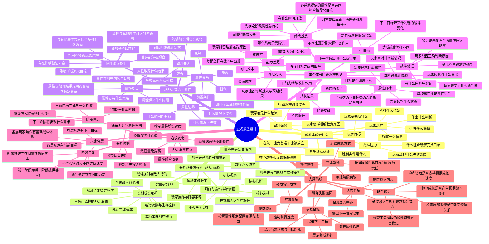
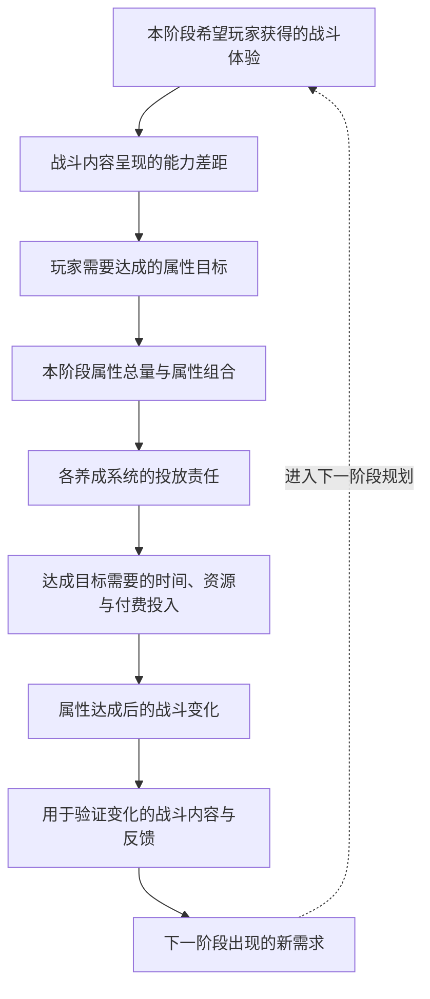

# 宏观数值设计脑图

## 本阶段目的

本阶段内容限定为正式文档的研究对象、推导顺序和章节范围。具体公式、参数和完整正文属于后续阶段。

本文研究的是宏观数值设计中的整体关系：

> 游戏怎样先确定战斗体验，再规划长期成长应该改变哪些战斗体验，并把这些变化连续转化为属性目标、养成投入、战斗验证和下一阶段追求。

## 正式文档流程

1. 脑图：确认研究对象、推导顺序和章节范围。
2. 章节任务：确认每章的核心结论、必须回答的问题和前后关系。
3. 正文初稿：按照确认后的章节任务逐章写作。
4. 内容评审：检查概念、因果关系、适用边界、遗漏与重复。
5. 正式稿：根据评审结论修订并形成最终 Markdown 文档。

第 1 阶段已经确认。下一阶段将逐章确定核心结论、必须回答的问题和前后关系。

## 核心判断

宏观数值设计需要依次回答四个问题：

1. 玩家要获得什么战斗体验。
2. 长期成长怎样参与战斗体验，规则、操作策略和长期数值能力分别承担什么。
3. 哪些可成长的战斗能力值得被定义成属性。
4. 怎样把属性目标、养成投入、战斗验证和下一阶段追求按阶段连续规划。

属性来自对战斗体验的两次判断：

```text
战斗体验
→ 判断成长应该改变什么
→ 判断哪些变化应由长期数值能力承担
→ 将长期数值能力转化为属性
```

## 外部资料补充后的判断

外部资料分别讨论了体验设计、战斗能力、成长阶段、养成投放和结果反馈，但很少把这些内容放进同一套推导过程中。本研究吸收其中能够补充宏观数值设计的部分，形成以下判断：

1. 战斗体验是属性设计的前提。设计者先确定玩家面对什么目标、压力和选择，再决定长期数值能力参与其中的方式。
2. 属性不是对战斗结果的任意量化。每项属性需要承担可区分的战斗职责，并在对应敌人、关卡或玩法中产生可以观察的作用。
3. 成长需要以阶段为单位规划。玩家需要知道当前遇到了什么问题、要达到什么状态、怎样获得、需要投入多少，以及达成后会发生什么变化。
4. 属性总目标应先于养成系统分配。设计者先确定一个阶段需要获得的能力变化，再决定不同养成系统分别提供多少、以什么方式提供。
5. 战斗、成长和奖励需要共同验证。属性投放改变战斗结果，战斗结果提供成长依据和奖励，奖励继续支持后续成长；其中任何一项变化都可能影响另外两项。
6. 内容系统同时承担提出需求和验证成长的职责。成长前，内容让玩家发现能力差距；成长后，同类或进阶内容让玩家确认属性带来的变化。
7. 玩家对属性的追求来自对关系的理解，而不是只看到面板数字。玩家需要理解战斗问题、属性作用、获得路径、达成标准和结果变化之间的关系。
8. 下一目标需要在当前目标完成前后逐步显现，使玩家能够判断继续投入会获得什么新的战斗能力和内容范围。

## 整体脑图



## 设计者的推导顺序

这张图描述设计者怎样从战斗体验推导数值规划。


## 玩家经历的追求过程

这张图描述玩家在单个成长阶段中实际经历的过程，与设计者的推导顺序属于两个观察角度。


## 单个成长阶段的完整规划

属性目标、养成投放和战斗验证需要在同一个成长阶段内同步规划。每个阶段同时确定以下内容：



## 拟定的正文结构

### 第一章：战斗体验是什么

定义战斗体验的组成：玩家目标、战斗压力、观察、判断、选择、行动、反馈和胜负原因。明确基础战斗体验必须在没有长期数值差距时也能成立。

### 第二章：长期成长怎样参与战斗体验

说明长期成长怎样影响效率、容错、挑战范围、策略成立条件和战斗职责，并明确规则、操作策略和长期数值能力各自承担的战斗体验。

### 第三章：数值能力在战斗体验中的职责边界

区分战斗规则、玩家操作、阵容策略和长期数值能力分别承担什么，避免把所有战斗体验都转化为属性差距。

### 第四章：怎样从战斗能力推导属性

说明一种战斗能力在什么条件下值得成为属性，属性需要承担什么职责，以及属性之间怎样形成取舍、组合、克制、替代和前置关系。

### 第五章：怎样规划单个成长阶段

把战斗体验、能力差距、属性目标、阶段属性总量、系统投放责任、投入成本、成长结果、战斗验证和下一目标作为同一个阶段整体规划。

### 第六章：怎样塑造玩家的属性追求

说明玩家怎样发现差距、理解属性作用、看见当前状态与目标距离、判断获得路径和投入要求，并建立投入能够改善战斗的预期。

### 第七章：怎样让成长结果在战斗中得到验证

说明验证内容怎样对应属性目标，怎样呈现达成前后的变化，以及怎样让玩家正确判断成功或失败的原因。

### 第八章：怎样连续规划多个成长阶段

说明新战斗需求怎样在旧能力基础上出现，新属性怎样延续旧属性价值，以及追求怎样从数值量级增长逐步扩展到属性组合、战斗职责和新策略。

### 第九章：玩家分层与长期数值控制

说明不同投入层级的玩家分别追求什么、以什么速度达成，怎样控制差距、历史投入贬值和追赶空间。

### 第十章：内容、养成、经济与信息系统的职责

说明内容系统负责提出能力需求和提供验证，养成系统按照阶段属性总目标承担投放，经济系统负责时间与成本，信息呈现负责帮助玩家理解原因、目标距离、路径与下一目标；同时说明战斗、成长和奖励怎样联合验证。

## 外部资料与正文用途

| 资料 | 可用于正文的内容 | 对应章节 |
|---|---|---|
| [MDA：A Formal Approach to Game Design](https://www.cs.northwestern.edu/~hunicke/MDA.pdf) | 从预期体验反推规则、行为过程与系统结果 | 第一章、第二章 |
| [The Fundamental Pillars of a Combat System](https://www.gamedeveloper.com/design/the-fundamental-pillars-of-a-combat-system) | 战斗能力需要有明确功能，敌人与战斗规则需要要求并验证这些能力 | 第一章、第四章、第七章 |
| [The Fundamentals of Game Progression](https://www.gamedeveloper.com/design/the-fundamentals-of-game-progression) | 进程设计需要明确目标、障碍、目标距离与能力选择 | 第一章、第六章 |
| [Project Horseshoe：Progression Systems](https://www.projecthorseshoe.com/reports/featured/ph14r3.htm) | 以单次成长为规划单位，组织投入、状态变化、预期和动机，并连接多个阶段 | 第五章、第六章、第八章 |
| [Breaking Down the Metagame Design in a Mobile RPG](https://www.gamedeveloper.com/design/breaking-down-the-metagame-design-in-a-mobile-rpg) | 战斗、成长和奖励相互影响，需要通过整体模拟和阶段检查共同验证 | 第五章、第七章、第十章 |
| [游戏数值策划](https://cloud.tencent.cn/developer/article/2078933?policyId=1003) | 从目标体验选择属性与公式，使用基础战斗基准和阶段节点检查结果 | 第一章、第四章、第五章 |
| [RPG数值核心设计思路梳理](https://gwb.tencent.com/community/detail/133900) | 核心玩法、属性框架、养成渠道、成长曲线和体验验证之间的关系 | 第四章、第五章、第十章 |
| [MMO游戏数值建模](https://gwb.tencent.com/community/detail/100387) | 属性与技能的职责划分、属性分类、成长上限以及属性在养成系统中的分配 | 第三章、第四章、第五章 |

## 本轮确认对象

本轮只确认以下整体结构：

1. 正式文档先定义战斗体验，再讨论长期成长怎样参与战斗体验。
2. 属性设计前必须先划分规则、操作策略和长期数值能力的职责。
3. 正文以“单个成长阶段的完整规划”为核心，再讨论多个阶段怎样连续。
4. 设计者推导顺序与玩家追求过程分别表达。
5. 经济系统在属性规划之后承担资源、速度和成本设计。
6. 单个阶段先确定属性总目标，再分配各养成系统的投放责任。
7. 内容系统既提出能力需求，也负责验证成长结果。
8. 战斗、成长和奖励需要共同检查，避免局部调整破坏其他阶段的体验与目标。
